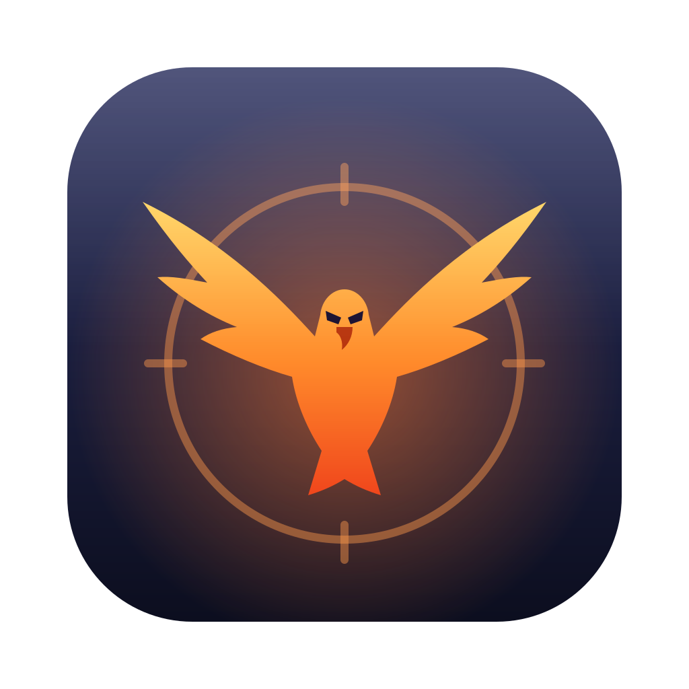
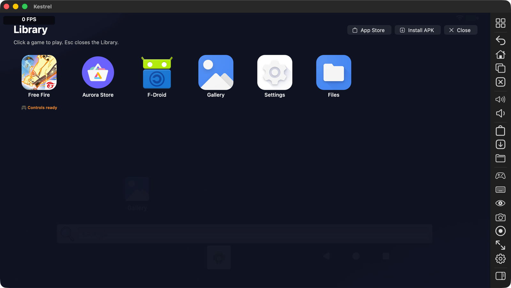
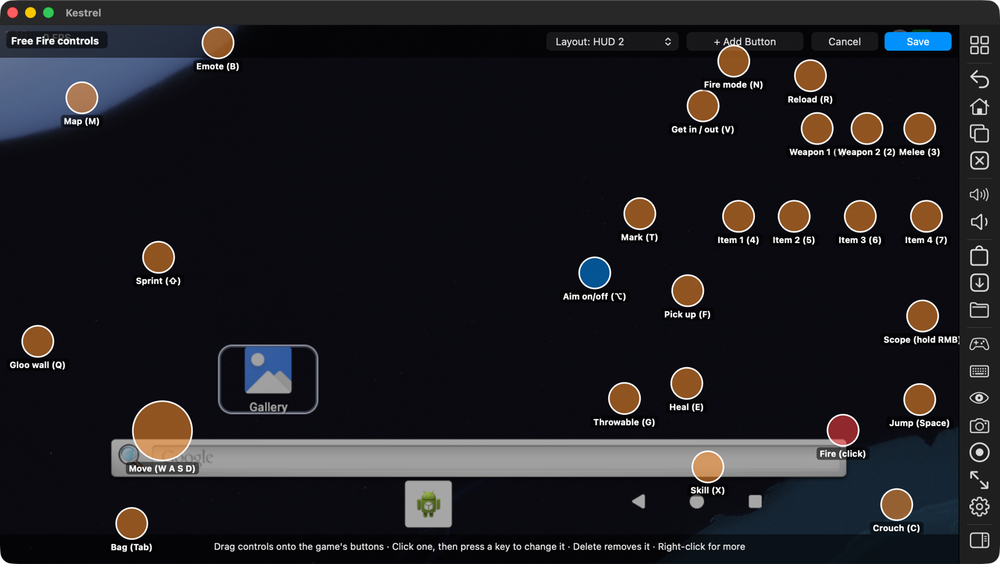
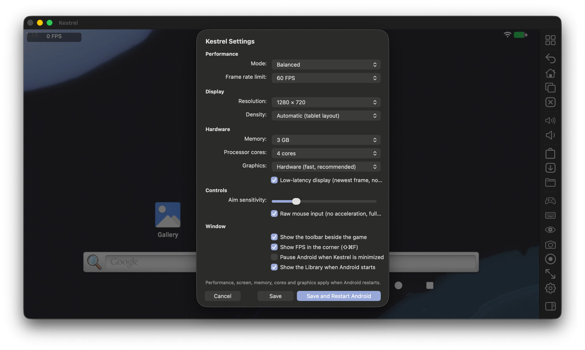

<p align="center">
  
</p>

<h1 align="center">Kestrel</h1>

<p align="center">
  <b>A lightweight Android emulator for Apple silicon Macs, written from scratch in C++.</b><br>
  Built to play <b>Free Fire</b> with a keyboard and mouse, smoothly, on an 8 GB Mac.
</p>

<p align="center">
  
</p>

---

## Why Kestrel

Most Android emulators for the Mac are big, run background services, or only make
sense on a powerful machine. Kestrel takes the opposite approach:

- **Light.** One native app, about 30 MB. No background services. Android boots to
  the home screen in about 7 seconds, and memory Android frees goes back to macOS.
- **Native.** Its own virtual machine monitor on Apple's `Hypervisor.framework`: the
  Android system runs directly on the Mac's CPU, and games draw on the Mac's GPU
  through Metal.
- **Made for games.** A full keymapper (WASD, mouse aim, fire, scope, any button on
  any key), raw mouse input, a low-latency display path, and layouts you can switch
  with a key.
- **Clean.** Kestrel never touches the game: no modified APKs, no injected code, no
  macros, no root, no faking a real phone. See [Fair play](#fair-play).

## Features

| | |
|---|---|
| 🎮 **Keymapper** | Joystick on WASD, mouse-look aiming, fire on the left button, hold-to-scope on the right, taps on any key or mouse side button. Visual editor, several layouts per game with a switch key each, import and export. |
| 🖱 **Aim that feels right** | Raw mouse input (no macOS acceleration, every report the mouse sends), one touch per input, touch lifts are never lost when Android is busy. |
| ⚡ **Fast graphics** | Guest Vulkan/OpenGL ES decoded by gfxstream and run on Metal through MoltenVK. Frames go straight into the window, with no copy. Frame rate follows the display (60/90/120 Hz). |
| 📊 **FPS and 1% lows** | An FPS badge with the 1% low, and a performance log (`perf.csv`) of every play session. |
| 🎬 **Recording** | Record the screen with game sound (H.264 + AAC) to `Movies/Kestrel` with ⇧⌘R. |
| 🧩 **Multi-instance** | Several Androids side by side, each with its own apps and accounts, sharing the system files (APFS clones: almost no extra disk). |
| 📦 **Apps** | Library with real app names and icons, install APKs by drag and drop, Aurora Store for downloads, send files to Android, paste from the Mac. |
| 🛟 **Reliability** | A graphics watchdog offers a restart if the picture freezes, crash notes and one-click problem reports, notices when a game closes unexpectedly, and a multi-hour soak test. |
| 🔊 **Sound and mic** | virtio-snd on CoreAudio, microphone only while an app records. |
| ⚙️ **Settings** | Performance modes, resolution, density, memory, cores, frame-rate limit, aim sensitivity. |

<p align="center">
  
  <br><sub>The controls editor: drag each control onto the game's button, click it and press a key to rebind.</sub>
</p>

<p align="center">
  
</p>

## Requirements

- A Mac with **Apple silicon** (M1 or later, or A-series).
- **macOS 15** or later.
- 8 GB of memory is enough; Android gets 3 GB by default.
- About 10 GB of free disk space for Android and your games (Android is downloaded on first launch).

## Build

```bash
git clone --recurse-submodules https://github.com/Justme-Cliff/kestrel.git
cd kestrel
tools/setup.sh                                   # Homebrew tools, submodules, patches, MoltenVK
cmake -B build -G Ninja -DCMAKE_BUILD_TYPE=RelWithDebInfo
cmake --build build                              # builds and signs build/Kestrel.app
open build/Kestrel.app
```

On first launch Kestrel downloads a pinned Android build from Google
([AOSP Cuttlefish](https://source.android.com/docs/devices/cuttlefish), arm64) with a
progress window. Everything after that is offline.

To make an installer: `tools/make-dmg.sh` builds `build/Kestrel-<version>.dmg`.

## Playing

1. Open **Kestrel**. The Library shows your apps; install games from **Aurora Store**
   or drop an `.apk` on the window.
2. Open the game. When Kestrel has controls for it, the key hints appear on screen.
3. Press **Option (⌥)** to start aiming: the cursor locks and the mouse turns the
   camera. Press it again to get the cursor back for menus.

| Key | Default action in Free Fire |
|---|---|
| W A S D | Move |
| Mouse / Left click / Right click (hold) | Aim / Fire / Scope |
| Space · C · Shift | Jump · Crouch · Sprint |
| R | Reload |
| 1 2 3 · 4 5 6 7 | Weapons · Item slots |
| F · E · Q · G · X | Pick up · Heal · Gloo wall · Throwable · Skill |
| V · T · B · N | Vehicle · Mark · Emote · Fire mode |
| Tab · M | Bag · Map |

Useful shortcuts: **⇧⌘K** edit controls, **⌘K** controls on/off, **⇧⌘F** FPS badge,
**⇧⌘R** record, **⌘S** screenshot, **⌘L** Library, **⌥⌘T** show/hide the toolbar.

Controls are plain JSON files in `~/Library/Application Support/Kestrel/profiles`;
Kestrel picks up changes to them by itself.

## How it works

```
┌───────────────────────────────── Kestrel.app (one process) ─────────────────────────────────┐
│  AppKit window + Metal ◀── frames ── gfxstream → MoltenVK (Vulkan/GLES → Metal)              │
│  Keymapper: keys/mouse → multi-touch ──▶ virtio-input                                       │
│  Devices: virtio-blk, net (own NAT), gpu, snd, input, vsock, balloon, rng, console · PCI    │
│  VMM core: guest memory, vCPU threads, GICv3, timers, PSCI                                  │
├────────────────────────────── Apple Hypervisor.framework ───────────────────────────────────┤
│  Android (Cuttlefish arm64, Google's GKI kernel)  →  your games                             │
└─────────────────────────────────────────────────────────────────────────────────────────────┘
```

macOS gives Kestrel an empty virtual machine. Kestrel maps part of its memory in as the
guest's RAM, loads Android's kernel and ramdisk with a device tree it generates, and
starts the virtual CPUs. They run at full hardware speed until the guest touches a
device; then Kestrel emulates that device and resumes. Every device is **virtio**, which
Android already has drivers for, so the guest runs unmodified.

Written for Kestrel: the VMM, interrupt setup, boot loader and device tree, the virtio
transport and every device, the user-mode network stack (TCP, UDP, DNS, DHCP; no root
and no extra permissions), the keymapper, the macOS app, and a small reader for
Android's disk formats. Reused: Google's gfxstream, Khronos' MoltenVK, and prebuilt
Android images. The details are in [docs/DESIGN.md](docs/DESIGN.md).

## Fair play

Garena allows emulators and matches emulator players against each other. Accounts get
banned for cheating, not for the emulator. Kestrel is built to stay on the right side:

- It never modifies, repacks or re-signs a game, and never injects code or reads game
  memory.
- One key press is one touch: no macros, no auto-fire, no recoil scripts, no aim assist,
  and nothing reads the screen to aim.
- Android isn't rooted, and Kestrel honestly reports itself as a virtual device.
- The guest clock always follows real time.

## Project layout

```
src/core        virtual machine, guest memory, vCPU threads, MMIO bus
src/arch/arm64  exits, system registers, PSCI, memory map
src/hv          Hypervisor.framework backend (only place that talks to it)
src/boot        Android boot images, device tree, module loading
src/devices     virtio transport and devices, PL011, PL031
src/net         user-mode NAT and the adb/vsock bridge
src/keymap      keymapper, profiles, touch generator (plain C++)
src/app         game controls, settings, assistant, reports
src/host/macos  window, Metal display, audio, raw mouse, recording
tests           unit tests (GoogleTest) and integration scripts
tools           setup, signing, DMG, soak test, latency probe
docs            design notes and screenshots
```

## Testing

```bash
ctest --test-dir build --output-on-failure   # unit + VM tests
tools/soak.sh --hours 3                      # long stability run on a throwaway copy of Android
```

## Status

Kestrel runs Free Fire on Apple silicon at the display's refresh rate with keyboard and
mouse. Not done yet: Intel Macs, Linux and Windows hosts, macOS 13–14 support, and
notarized releases (which need an Apple Developer ID). See the plan in
[docs/DESIGN.md](docs/DESIGN.md#6-build-plan-phases).

## License notes

Third-party code keeps its own license: gfxstream, MoltenVK, the Vulkan loader and
GoogleTest are Apache-2.0 or BSD. Android is downloaded from Google at first launch and
not redistributed. See [third_party/LICENSES.md](third_party/LICENSES.md). Free Fire is
a trademark of Garena; Kestrel is not affiliated with Garena or Google.
